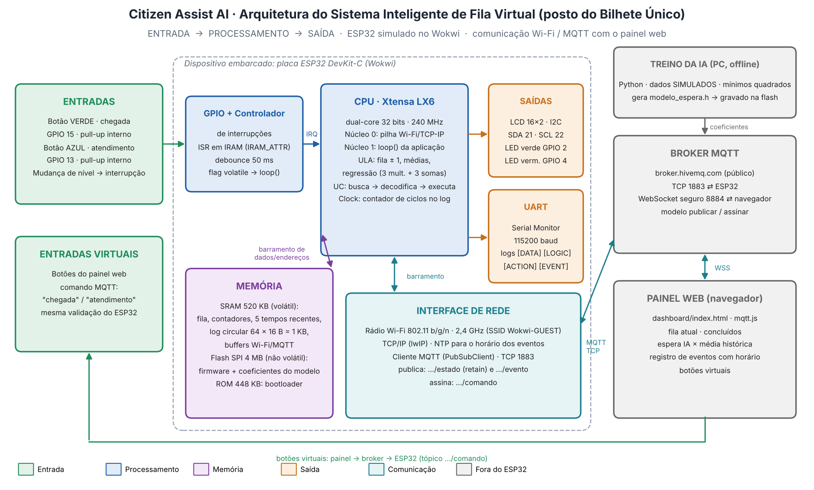

# Citizen Assist AI · Sistema Inteligente de Gerenciamento de Filas Virtuais

Global Solution 2026.2 · FIAP · 1CC-FEV · **Computer Organization and Architecture**

| Integrante | RM |
|---|---|
| Gabriel Fagundes | 569074 |
| Glauco Kelly | 572840 |
| Thiago Renatino | 569073 |

Protótipo de fila virtual para um **posto de atendimento do Bilhete Único** (projeto Citizen Assist AI Mobilidade).
Um ESP32, simulado no Wokwi, registra a chegada de cidadãos e a conclusão de atendimentos por botões físicos
(interrupção), impede contagens negativas, guarda os eventos com horário, estima o tempo de espera com
regressão linear e envia tudo por Wi-Fi/MQTT para um painel web aberto no navegador.

**Vídeo de demonstração:** https://youtu.be/lUodChs_Yjc · **Projeto no Wokwi:** https://wokwi.com/projects/480962115318032385



## Estrutura

```
citizen-assist-ai-computer-organization/
├── firmware/            ESP32 (Wokwi): sketch.ino, modelo_espera.h, diagram.json, libraries.txt
├── dashboard/           painel web: index.html (abrir no navegador)
├── ia/                  previsão de espera: dados SIMULADOS, treino, métricas e gráficos
│   ├── gerar_dados_simulados.py
│   ├── treinar_previsao.py
│   ├── dados/historico_atendimentos_SIMULADO.csv
│   └── resultados/      metricas.json, real_x_previsto.png, erro_por_fila.png
├── docs/                diagrama de arquitetura, relatório técnico (PDF), evidências e roteiro do vídeo
└── README.md
```

## Como executar

### 1. Firmware no Wokwi
**Projeto pronto no Wokwi:** https://wokwi.com/projects/480962115318032385 (basta abrir e clicar em ▶).

Para montar do zero:
1. Acesse https://wokwi.com e crie um projeto **ESP32**.
2. Substitua `sketch.ino` e `diagram.json` pelos arquivos da pasta `firmware/`.
3. Crie o arquivo `modelo_espera.h` (menu ▾ ao lado das abas → *New file…*) e cole o conteúdo.
4. Em **Library Manager**, adicione `PubSubClient` e `LiquidCrystal I2C` (ou cole `libraries.txt`).
5. Clique em ▶ (Start the simulation). O Serial Monitor mostra os logs `[INFO] [NET] [DATA] [LOGIC] [ACTION] [EVENT]`.

Botão **verde** = chegada (GPIO 15) · botão **azul** = atendimento concluído (GPIO 13).
O LCD mostra a fila, os atendimentos concluídos e as duas estimativas de espera.

> Modo demonstração: **1 segundo real = 1 minuto do posto** (`ESCALA_DEMO` no firmware), para a
> demonstração caber no vídeo.

### 2. Painel web
Abra `dashboard/index.html` no navegador (duplo clique). Ele se conecta ao broker
`broker.hivemq.com` por WebSocket seguro e mostra, em tempo real:
fila atual, espera estimada (IA e média histórica), atendimentos concluídos, registro de eventos e
dados do dispositivo. Os botões virtuais do painel enviam comandos ao ESP32, que faz a mesma validação dos
botões físicos.

### 3. Previsão inteligente (Python)
```bash
pip install numpy pandas matplotlib
cd ia
python gerar_dados_simulados.py   # gera o histórico SIMULADO (30 dias, 1 guichê)
python treinar_previsao.py        # compara média histórica x regressão e gera firmware/modelo_espera.h
```

## Previsão de espera (Etapa 3)

Dados **simulados** e identificados como tal (coluna `origem = SIMULADO`): 3.164 chegadas em 30 dias,
treino nos dias 1 a 21 e teste nos dias 22 a 30.

| Método | Fórmula | MAE (teste) | RMSE | R² |
|---|---|---|---|---|
| Convencional | fila × média histórica (4,17 min) | 5,33 min | 8,81 min | 0,882 |
| IA · regressão linear | −2,813 + 3,342·fila + 0,356·(fila × tempo médio dos 5 últimos) | **4,83 min** | **7,23 min** | **0,921** |

A regressão reduz o erro médio absoluto em 9,4%. O ESP32 executa a inferência a cada evento
(3 multiplicações e 3 somas em ponto flutuante).

## Comunicação (Etapa 4)

| Tópico MQTT | Sentido | Conteúdo |
|---|---|---|
| `fiap/gs2026/citizenassist/fila/posto-bu-01/estado` | ESP32 → painel (retain) | fila, concluídos, esperas, tempos médios, ciclo, heap, horário |
| `…/evento` | ESP32 → painel | CHEGADA, CONCLUSAO, SAIDA_FILA_VAZIA, FILA_CHEIA, com horário e ciclo |
| `…/comando` | painel → ESP32 | `chegada`, `atendimento`, `estado` |

## Testes mínimos

Os quatro testes do enunciado (chegada, conclusão, saída com fila vazia e atualização da estimativa)
estão registrados com entradas, resultado esperado e resultado observado no relatório técnico
(`docs/relatorio_tecnico_fila_virtual.pdf`).

## Solução de problemas

- **"WiFi Error: Connection to IoT Gateway failed" no Wokwi:** a rede ou uma extensão do navegador bloqueou o
  gateway de internet do Wokwi. Reinicie a simulação, desative bloqueadores/VPN para wokwi.com ou use outra rede.
  A fila, o LCD e os LEDs continuam funcionando sem Wi-Fi; só o painel web deixa de receber dados.
- **Painel em "aguardando dados":** confirme no Serial Monitor as linhas `Wi-Fi OK`, `MQTT ... OK` e
  `NTP sincronizado`, e mantenha a aba do Wokwi visível (o simulador desacelera em segundo plano).

## Limitações

- Broker MQTT público, sem autenticação: adequado a protótipo, não a produção.
- O modelo foi treinado com dados simulados; em uso real deve ser re-treinado com o histórico do posto.
- O log de eventos fica na RAM (64 eventos) e se perde ao reiniciar; a persistência na flash é uma evolução.
